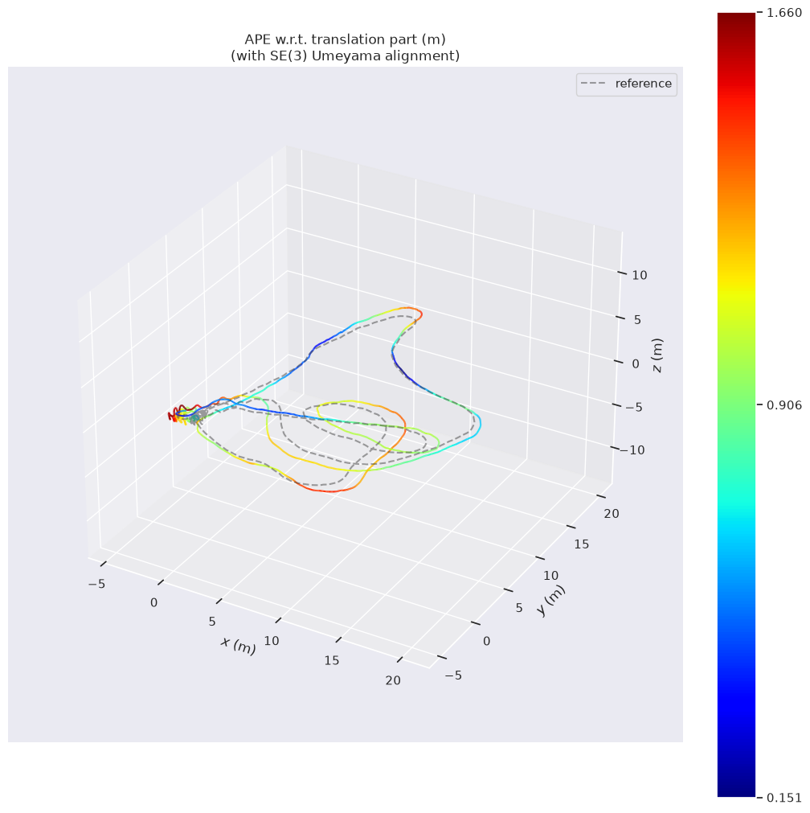
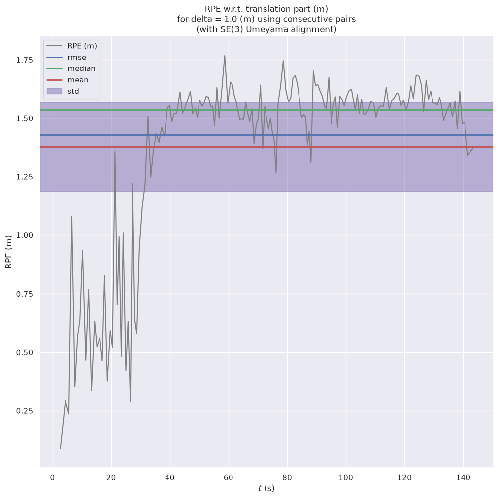

# PL-VINS on ROS 2 Jazzy

PL-VINS was ported to ROS 2 Jazzy, and its build was updated for Ubuntu 24.04
and C++17. Motion is estimated from point and line features; loop closure can
be enabled when needed.

The previous README is preserved in [README.original.md](README.original.md).
More detail is provided in [the architecture notes](docs/architecture.md) and
[LaMAria replay notes](docs/lamaria.md).

## What I changed

- The runtime was migrated to ROS 2 packages, launch files, parameters,
  services, publishers, and subscribers. ROS 2 messages, simulated time, and
  sensor QoS are used by the estimator and feature tracker.
- The build dependencies were pinned to OpenCV 5.0, Eigen 5.0, Ceres 2.2,
  SuiteSparse 7.14, Boost 1.92, glog 0.7, and `cv_bridge` 4.1. Compatibility
  patches were added for the newer OpenCV and Eigen APIs.

## Build

With ROS 2 Jazzy installed, the workspace can be built and set up with:

```bash
bash tools/build.sh
source tools/setup.bash
```

The Python tools, including EVO, can be installed in a local environment with:

```bash
python3 -m venv --system-site-packages .venv
.venv/bin/pip install --require-hashes -r requirements.lock -r requirements-evo.lock
```

## Run LaMAria

After the dataset is made available under `/datasets/lamaraia`, a sequence can
be run with:

```bash
source tools/setup.bash
.venv/bin/python tools/run_lamaria.py \
  --dataset-root /datasets/lamaraia \
  --sequence R_01_easy \
  --output-root results/lamaria
```

A new folder is created for each run under its sequence, using the UTC start
time, playback rate, and loop-closure setting in its name. Earlier runs are
preserved, and the trajectories, ROS logs, EVO summaries, result archives, and
plots are saved there. A short folder label can be supplied with
`--run-label retry3`. Loop closure can be enabled with `--loop-closure`, or EVO
can be skipped with `--no-evaluate`.

## Example results

The following results were recorded in one saved `R_01_easy` run at 0.5x
playback with loop closure off. APE is reported as translation error after
SE(3) alignment. RPE is measured over 1 m. These example results were
calculated against LaMAria's dense pseudo-ground-truth; the official
control-point benchmark score is not represented.

| Metric | Mean | RMSE | Plot |
|---|---:|---:|---|
| APE translation (m) | 0.969 | 1.022 |  |
| RPE translation per 1 m (m) | 1.378 | 1.429 |  |

For the same run, rotation RPE over 1 m was 13.433° mean and 20.858° RMSE.

## License

This project is licensed under GPLv3; see [LICENCE](LICENCE). The original
research citation is retained in [support_files/paper_bib.txt](support_files/paper_bib.txt).
