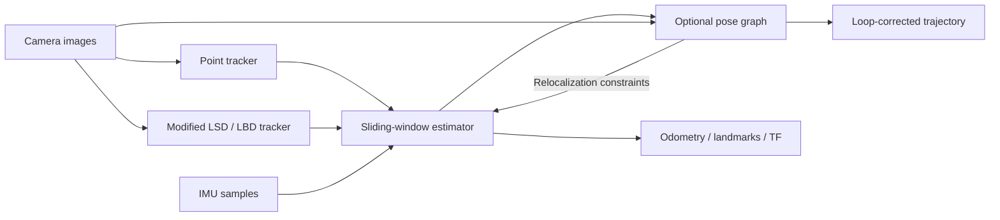

# Architecture

The runtime consists of independent ROS 2 processes. Camera images feed the point
tracker (corners, optical flow and geometric rejection) and the modified LSD/LBD
line tracker. Both publish observations carrying the original image timestamp.
`plvins_estimator` matches those timestamps and brackets them with IMU samples.
It initializes camera/IMU geometry, preintegrates IMU motion, optimizes point and
orthonormal line landmarks in a sliding window, and marginalizes old states.

The optional `pose_graph` process receives keyframes and raw images, extracts
BRIEF descriptors, queries the existing DBoW vocabulary, verifies candidate loops
with PnP, and optimizes a four-degree-of-freedom graph. Its match-point topic
feeds relocalization constraints back to the estimator. Vocabulary and pattern
files remain installed runtime assets because replacing their descriptor format
would invalidate the existing vocabulary.

`camera_model` provides pinhole, equidistant, Mei and Scaramuzza projection models
and calibration; its math library has no ROS dependency. `camera_calibration` is
a standalone image-based calibration CLI.
`image_node_b` overlays tracked points and lines on rectified images.
`pub_imu_features` and `benchmark_publisher` provide simulation and ground-truth
inputs; their data directories are explicit parameters.

The estimator and trackers own their subscription state. Estimation runs on a
joined worker thread; sensor callbacks maintain bounded queues and an independent
IMU prediction state. The pose graph starts its optimization worker after ROS
initialization and joins workers during shutdown. A save service replaces terminal
input, which could block shutdown in the original program.

## Interfaces

The original topic and frame conventions are retained. Images and IMU use sensor
QoS; internal feature and pose topics use reliable QoS. Feature transport remains
`sensor_msgs/msg/PointCloud`: point coordinates contain normalized rays, with
channels `[id, pixel_u, pixel_v]`; line coordinates contain the normalized start,
with channels `[id, normalized_end_x, normalized_end_y]`. IDs retain the original
`feature_id * camera_count + camera_id` packing. The image overlay projects
normalized line endpoints through the rectified intrinsic matrix rather than
reading nonexistent pixel channels.

Calibration files remain OpenCV YAML, selected with `config_file`. They are not
ROS parameter YAML. `output_directory`, `pose_graph_directory`, and `use_sim_time`
are ROS parameters. Package resources are found through the ament index.

## Dependency boundaries

Pinned source archives and compatibility adjustments are recorded in
`dependencies.lock.json` and applied by `tools/bootstrap_dependencies.py`.
OpenCV, Eigen, Ceres, SuiteSparse, Boost headers and glog are built or installed
under `.deps/install`. No system library installation is overwritten. The Jazzy
C++ image bridge is rebuilt against OpenCV 5; its Python bindings are unnecessary
for the supplied tools and are disabled. Python tools use Pillow and native ROS
serialization, avoiding a second OpenCV Python installation.

Jazzy remains the ROS API baseline. RViz runs in its own process and can use its
Ubuntu-provided OpenCV. Additional camera drivers and compressed image plugins
that link OpenCV must be rebuilt against the same OpenCV version before loading
them into a migrated process. BLAS, image-codec and operating-system dependencies
remain supplied by supported Ubuntu packages.

The bundled modified line detector is intentionally preserved as project code.
It is built from source rather than replaced with an unrelated detector. Unused
Sophus and estimator-local loop-closure copies are removed; the active pose graph
retains the compatible BRIEF/DBoW implementation and original license notices.
